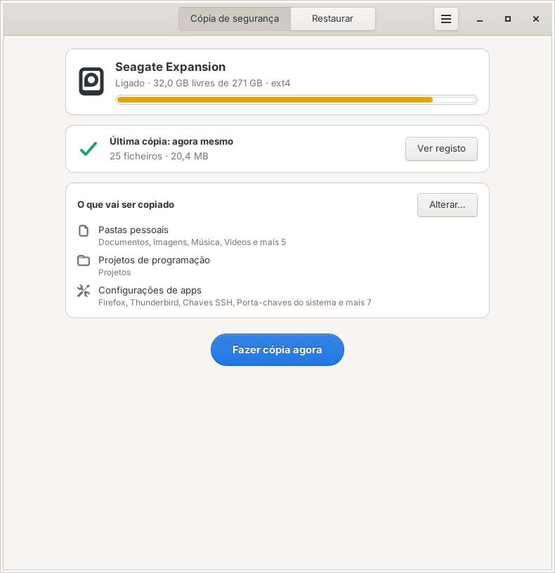
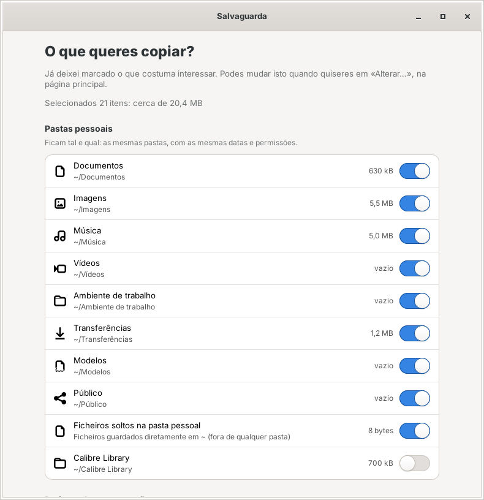
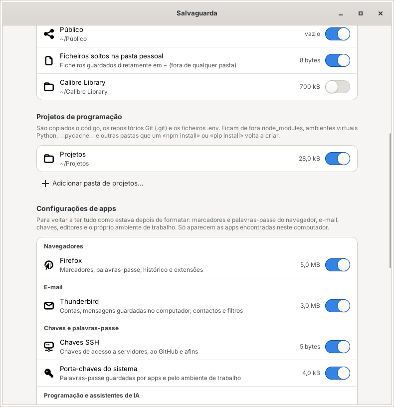
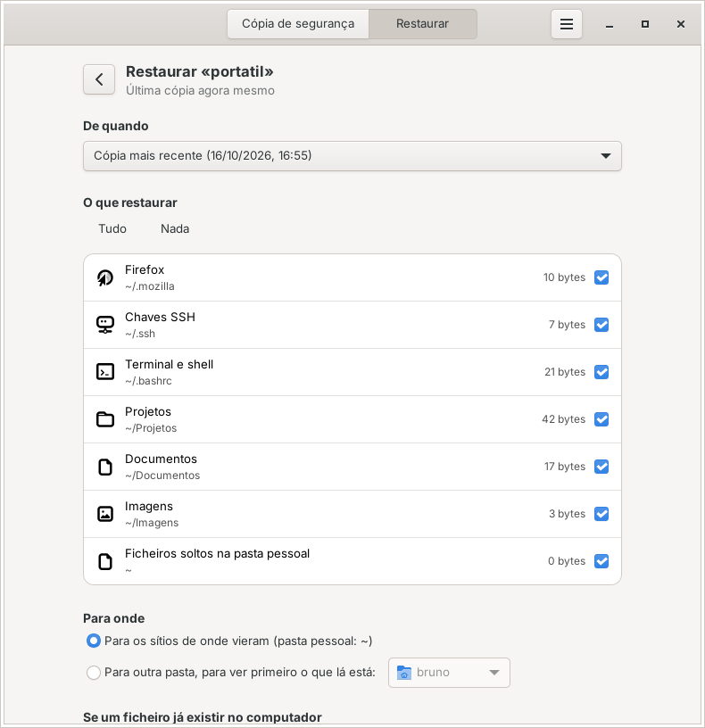

# Salvaguarda

Cópias de segurança simples e fiéis para um disco externo, em Linux Mint, Ubuntu, Debian e
outras distribuições baseadas em Debian. Instala-se com dois cliques, funciona sem internet e
guarda os ficheiros tal e qual: as mesmas pastas, as mesmas datas e as mesmas permissões, para
voltarem ao sítio certo depois de formatares o computador.



## O que faz

- **Um botão, uma cópia.** Abres a app, ligas o disco e carregas em «Fazer cópia agora». Só é
  copiado o que mudou desde a última vez.
- **Espelho com versões anteriores.** A pasta «Cópia atual» fica igual ao computador. O que
  apagares ou alterares não se perde: passa para «Versões anteriores», numa pasta com a data,
  e é limpo automaticamente ao fim do prazo que escolheres (6 meses por omissão) ou quando
  faltar espaço.
- **Sabe onde as apps guardam as coisas.** Marcadores e palavras-passe do Firefox, Chrome,
  Brave e afins, e-mail do Thunderbird, chaves SSH e GPG, porta-chaves do sistema, Git,
  VS Code, Cursor, Windsurf, assistentes de IA (Claude Code, Codex, Gemini CLI...), terminal,
  LibreOffice e as definições do próprio ambiente de trabalho (painel, atalhos, aparência).
  Só aparecem as que existirem no computador.
- **Pensada para projetos de programação.** Copia o código, os repositórios `.git` e os
  ficheiros `.env`, e deixa de fora `node_modules`, ambientes virtuais Python, `__pycache__`
  e outras pastas que um `npm install` ou `pip install` volta a criar.
- **Restauro guiado.** Depois de formatar, a app reconhece o disco, propõe restaurar e devolve
  cada ficheiro ao sítio, mesmo que o teu utilizador tenha agora outro nome ou que o sistema
  esteja noutro idioma (a pasta «Documentos» vai para «Documents», por exemplo).
- **Leva-se a si própria.** Cada cópia guarda também a app e um `LEIA-ME.txt` no disco, para
  poderes restaurar sem instalar nada e sem internet.
- **Protege-te de surpresas.** Se uma pasta desaparecer ou não puder ser lida, a cópia
  existente é mantida. Se de repente muitos ficheiros desaparecerem (um apagão acidental, por
  exemplo), a app pergunta antes de mexer na cópia.

| Escolher o que copiar | Projetos de programação | Restaurar depois de formatar |
| --- | --- | --- |
|  |  |  |

## Instalar

1. Descarrega o ficheiro [`dist/salvaguarda_1.0.0_all.deb`](dist/salvaguarda_1.0.0_all.deb).
2. Faz duplo clique no ficheiro e escolhe «Instalar pacote». Em alternativa, no terminal:

   ```sh
   sudo apt install ./salvaguarda_1.0.0_all.deb
   ```

3. Abre a Salvaguarda a partir do menu de aplicações.

Não precisa de internet: a app usa apenas o Python 3 e o GTK 3, que já vêm instalados no
Linux Mint e no Ubuntu e, em geral, nos ambientes gráficos baseados em GTK (Cinnamon, GNOME,
MATE, Xfce). Se o instalador disser que faltam `python3-gi` ou `gir1.2-gtk-3.0` (pode
acontecer em ambientes KDE ou em instalações mínimas), instala-os uma vez com
`sudo apt install python3-gi gir1.2-gtk-3.0`.

Para desinstalar: `sudo apt remove salvaguarda` (as cópias no disco não são tocadas).

## Primeira utilização

1. **Escolhe o disco.** Liga o disco externo e escolhe-o na lista. As cópias ficam numa pasta
   `Salvaguarda` dentro do disco, por isso o disco pode ter outras coisas.
2. **Escolhe o que copiar.** As pastas pessoais e as configurações das apps encontradas já vêm
   marcadas. Adiciona as tuas pastas de projetos e quaisquer outras pastas ou ficheiros.
3. **Faz a primeira cópia.** Copia tudo e pode demorar; as seguintes só copiam o que mudou.
   No fim, usa «Ejetar disco» antes de o desligar.

O disco ideal está formatado em **ext4**, porque é o formato que guarda as permissões e as
ligações simbólicas do Linux. Discos em exFAT, NTFS ou FAT32 funcionam, mas a cópia não fica
fiel (as chaves SSH, por exemplo, perdem a proteção); a app avisa e oferece abrir a app Discos
para formatar. Na app **Discos**, ao criar a partição, escolhe o tipo ext4 (a opção para uso
só em sistemas Linux). Formatar apaga o que está no disco. Se escolheres também a proteção
por palavra-passe (LUKS), o disco fica cifrado: é recomendado, porque as cópias incluem
chaves, palavras-passe guardadas e ficheiros `.env`. O Linux Mint pede a palavra-passe sempre
que ligas o disco e a Salvaguarda funciona igual.

## Depois de formatar o computador

Com a app (recomendado):

1. Instala a Salvaguarda com o `.deb`, ou abre a cópia que está no próprio disco: pasta
   `Salvaguarda/Aplicação`, duplo clique em `Abrir a Salvaguarda.sh`, «Executar».
2. Ao escolher o disco, a app avisa que já tem cópias e propõe **Restaurar agora**.
3. Confirma o que queres restaurar e carrega em «Restaurar». Por omissão, cada ficheiro volta
   ao sítio de onde veio e, se já existir um ficheiro com o mesmo nome, o que lá estava é
   guardado à parte em `~/.local/share/salvaguarda/substituidos/`.
4. Se restauraste as definições do ambiente de trabalho, termina a sessão e volta a entrar.

A partir daí, as cópias continuam na mesma pasta do disco, como antes.

Sem a app, os ficheiros estão no disco como qualquer outra pasta. No terminal, para manter
datas e permissões:

```sh
cp -a "/media/$USER/<disco>/Salvaguarda/<computador>/Cópia atual/Pasta pessoal/." ~/
```

## Como fica o disco

```
Salvaguarda/
├── LEIA-ME.txt                  como restaurar, mesmo sem a app
├── disco.json                   identifica o disco (não apagar)
├── Aplicação/                   a app, pronta a usar sem instalar
└── <computador>/
    ├── Cópia atual/
    │   ├── Pasta pessoal/       espelho do que escolheste em /home/<utilizador>
    │   ├── Outras localizações/ pastas de fora da pasta pessoal, com o caminho completo
    │   └── Extras/              definições do ambiente de trabalho (dconf)
    ├── Versões anteriores/
    │   └── 2026-10-16_15-30-12/ o que foi apagado ou substituído nessa cópia
    └── Registos/                relatório de cada cópia
```

Podes usar o mesmo disco para vários computadores (cada um tem a sua pasta) e vários discos
para o mesmo computador (por exemplo, um em casa e outro noutro sítio).

## O que não é copiado

Por omissão ficam de fora coisas que ocupam espaço e se recriam sozinhas. Tudo isto se muda em
**Definições**:

- **Caches, lixo e temporários:** `~/.cache`, Lixo, miniaturas, caches dos navegadores,
  transferências incompletas, ficheiros de bloqueio do LibreOffice e do Office, e qualquer
  pasta marcada com `CACHEDIR.TAG`.
- **Dependências e ficheiros gerados de projetos:** `node_modules`, ambientes virtuais Python
  (qualquer pasta com `pyvenv.cfg`), `__pycache__`, `.next`, `.nuxt`, `.svelte-kit`, `.turbo`,
  `.parcel-cache`, `.pytest_cache`, `.mypy_cache`, `.ruff_cache`, `.tox`, `.terraform` e afins.
  As pastas `dist` e `build` são copiadas, porque às vezes têm conteúdo próprio.
- **Ferramentas e pacotes reinstaláveis:** `~/.npm`, `~/.cargo/registry`, `~/.rustup`,
  versões do Node (nvm, volta, fnm) e do Python (pyenv, uv), `go/pkg/mod`, extensões dos
  editores, Flatpak, contentores, modelos de IA locais (Ollama, LM Studio) e jogos do Steam.
- **Exclusões personalizadas:** uma por linha, por exemplo `*.iso`, `Transferências/Filmes/` ou
  `/media/dados/tmp`.

Também nunca são copiados ficheiros de sistema (`/etc`, `/usr`...), sockets e pipes, nem outros
discos montados dentro das pastas escolhidas (adiciona-os como pasta própria se os quiseres).

## Atalho de teclado

`salvaguarda --copiar` faz a cópia sem abrir a janela, para o primeiro disco de cópias ligado.
No Cinnamon, cria um atalho personalizado em Definições do sistema, Teclado, Atalhos, com o
comando `salvaguarda --copiar`.

## Limitações conhecidas

- Copia os ficheiros do teu utilizador; ficheiros de outros utilizadores ou do administrador
  que não consegues ler aparecem como avisos no relatório.
- Ligações rígidas (hard links) são copiadas como ficheiros independentes e ficheiros esparsos
  (algumas imagens de máquinas virtuais) passam a ocupar o tamanho total.
- Bases de dados abertas (navegador, e-mail) podem ficar incoerentes se as apps estiverem
  abertas durante a cópia; a app avisa antes de começar.
- Não guarda a lista de aplicações instaladas.

## Para quem desenvolve

```sh
python3 -m salvaguarda                     # abre a app a partir do código-fonte
python3 -m unittest discover -s tests -t . # testes (Python 3.8 ou mais recente)
./packaging/build-deb.sh                   # cria dist/salvaguarda_<versão>_all.deb
```

Organização do código:

- `salvaguarda/core/`: motor sem interface gráfica (seleção, exclusões, cópia, restauro,
  relatórios). Testado em `tests/`.
- `salvaguarda/ui/`: interface em GTK 3, escolhido por já vir instalado em todas as
  distribuições Debian com ambiente gráfico e por seguir o tema do Linux Mint (incluindo o
  modo escuro).
- `packaging/`: script e metadados do pacote `.deb`.

## Licença

GPL-3.0-or-later. Ver [LICENSE](LICENSE).
